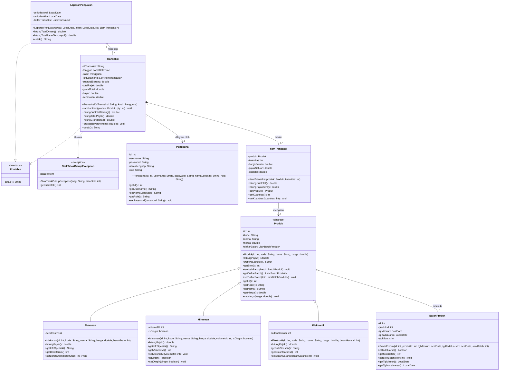

# Java Class Schema — SI-RITEL

Dokumen ini merupakan pembaruan rancangan kelas Java setelah penambahan fitur **Multi-Batch Inventory (`BatchProduk`)** dan pemisahan atribut kemasan pada subclass `Makanan` (`beratGram`) serta `Minuman` (`volumeMl`, `isDingin`).

---

## 1. Struktur Direktori Proyek (Eclipse / Standard Java)

```text
SI-RITEL/
├── AGENTS.md
├── docs/
│   ├── database_schema.md
│   └── java_class_schema.md
├── lib/
│   └── postgresql-42.x.x.jar          # Driver pgJDBC
└── src/
    └── com/
        └── siritel/
            ├── Main.java                      # Entry point aplikasi
            ├── config/
            │   └── DatabaseConnection.java    # Koneksi JDBC PostgreSQL
            ├── exception/
            │   └── StokTidakCukupException.java
            ├── model/
            │   ├── Printable.java             # Interface cetak nota & laporan
            │   ├── Pengguna.java
            │   ├── Produk.java                # Abstract class
            │   ├── Makanan.java               # Subclass Produk
            │   ├── Minuman.java               # Subclass Produk
            │   ├── Elektronik.java            # Subclass Produk
            │   ├── BatchProduk.java           # Entitas batch stok & kedaluwarsa
            │   ├── ItemTransaksi.java
            │   ├── Transaksi.java
            │   └── LaporanPenjualan.java
            ├── dao/
            │   ├── PenggunaDAO.java
            │   ├── ProdukDAO.java
            │   └── TransaksiDAO.java
            ├── controller/
            │   ├── AuthController.java
            │   ├── ProdukController.java
            │   └── TransaksiController.java
            └── view/
                ├── LoginView.java
                ├── MainFrame.java
                ├── ManajemenPenggunaView.java
                ├── ManajemenProdukView.java
                ├── KasirView.java
                ├── RiwayatTransaksiView.java
                └── LaporanPenjualanView.java
```

---

## 2. Class Diagram (Mermaid)



---

## 3. Spesifikasi Detail Kelas & Aturan Bisnis

### A. Package `com.siritel.model`

1. **`Printable` (Interface)**
   * `String cetak()`: Mengembalikan representasi teks terformat untuk struk belanja (`Transaksi`) dan rekap laporan (`LaporanPenjualan`).
2. **`Produk` (Abstract Class)**
   * **Atribut:** `protected int id`, `protected String kode`, `protected String nama`, `protected double harga`, `protected List<BatchProduk> daftarBatch`.
   * **Validasi Setter:** `setHarga(double harga)` melempar `IllegalArgumentException` jika `harga < 0`. `setKode` dan `setNama` menolak string kosong/null.
   * **Agregasi Stok:** `public int getStok()` menjumlahkan `batch.getStokBatch()` dari seluruh elemen `daftarBatch` (yang belum kedaluwarsa atau seluruh stok aktif).
   * **Abstract Methods:**
     * `public abstract double hitungPajak();`
     * `public abstract String getInfoSpesifik();`
3. **`Makanan` (Subclass `Produk`)**
   * **Atribut:** `private int beratGram` (validasi `beratGram > 0`).
   * **Polimorfisme `hitungPajak()`:** Pajak rendah produk pangan sebesar **$5\%$** dari harga dasar (`return harga * 0.05;`).
   * **`getInfoSpesifik()`:** Mengembalikan `beratGram + " gram"`.
4. **`Minuman` (Subclass `Produk`)**
   * **Atribut:** `private int volumeMl` (validasi `volumeMl > 0`), `private boolean isDingin`.
   * **Polimorfisme `hitungPajak()`:** PPN **$11\%$** dari harga dasar, ditambah biaya layanan pendingin sebesar **Rp 500** apabila `isDingin == true` (`return (harga * 0.11) + (isDingin ? 500.0 : 0.0);`).
   * **`getInfoSpesifik()`:** Mengembalikan `volumeMl + " ml" + (isDingin ? " (Dingin)" : "")`.
5. **`Elektronik` (Subclass `Produk`)**
   * **Atribut:** `private int bulanGaransi` (validasi `bulanGaransi >= 0`).
   * **Polimorfisme `hitungPajak()`:** PPN **$11\%$** + pajak/asuransi barang elektronik **$4\%$** (total **$15\%$**), dan jika `bulanGaransi > 12` ditambah **$2\%$** (`double rate = (bulanGaransi > 12) ? 0.17 : 0.15; return harga * rate;`).
   * **`getInfoSpesifik()`:** Mengembalikan `"Garansi " + bulanGaransi + " bln"`.
6. **`BatchProduk`**
   * **Atribut:** `private int id`, `private int produkId`, `private LocalDate tglMasuk`, `private LocalDate tglKadaluarsa` (nullable untuk elektronik), `private int stokBatch` (validasi `stokBatch >= 0`).
7. **`ItemTransaksi`**
   * Saat konstruktor `ItemTransaksi(Produk produk, int kuantitas)` dipanggil, langsung menyimpan `this.hargaSatuan = produk.getHarga()` dan `this.pajakSatuan = produk.hitungPajak()` (pemanggilan polimorfik) sehingga perubahan harga master di masa depan tidak mengubah histori nota lama.
8. **`Transaksi` (implements `Printable`)**
   * `tambahItem(Produk p, int qty)`: Memvalidasi apakah `qty + qtySudahDiKeranjang <= p.getStok()`. Jika tidak cukup, melempar `StokTidakCukupException`. Jika produk sudah ada di `listKeranjang`, cukup tambahkan kuantitasnya.
   * `prosesBayar(double nominal)`: Memvalidasi `nominal >= hitungGrandTotal()`, lalu menghitung `kembalian = nominal - grandTotal`.

### B. Package `com.siritel.dao` & `controller`

* **`ProdukDAO`:**
  * `insert(Produk p)`, `update(Produk p)`, `delete(int id)`
  * `getAll()`: Membaca tabel `produk` sekaligus mengisi `daftarBatch` dari tabel `batch_produk` untuk setiap produk.
  * `tambahBatch(BatchProduk batch)` & `getBatchByProdukId(int produkId)`
* **`ProdukController`:**
  * `tambahProduk(Produk p)`, `ubahProduk(Produk p)`, `hapusProduk(int id)`, `tambahStokBatch(BatchProduk b)`
  * **Method Overloading:**
    * `List<Produk> cariProduk(String keyword)`
    * `List<Produk> cariProduk(String keyword, String jenisProduk)`
* **`TransaksiDAO` & `TransaksiController`:**
  * `checkout(Transaksi t)`: Menjalankan `TransaksiDAO.simpanTransaksi(t)` yang secara atomik menyimpan header `transaksi`, seluruh `item_transaksi`, dan memotong `stok_batch` menggunakan urutan **FEFO** (`ORDER BY tgl_kadaluarsa ASC NULLS LAST`).
  * `buatLaporan(LocalDate awal, LocalDate akhir)`: Mengambil riwayat transaksi pada periode tersebut dan membungkusnya dalam objek `LaporanPenjualan`.