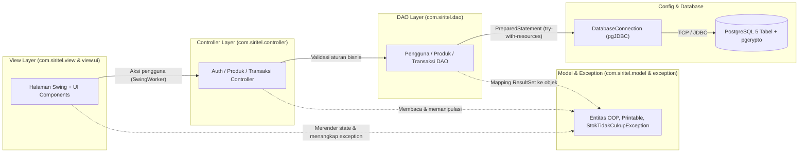
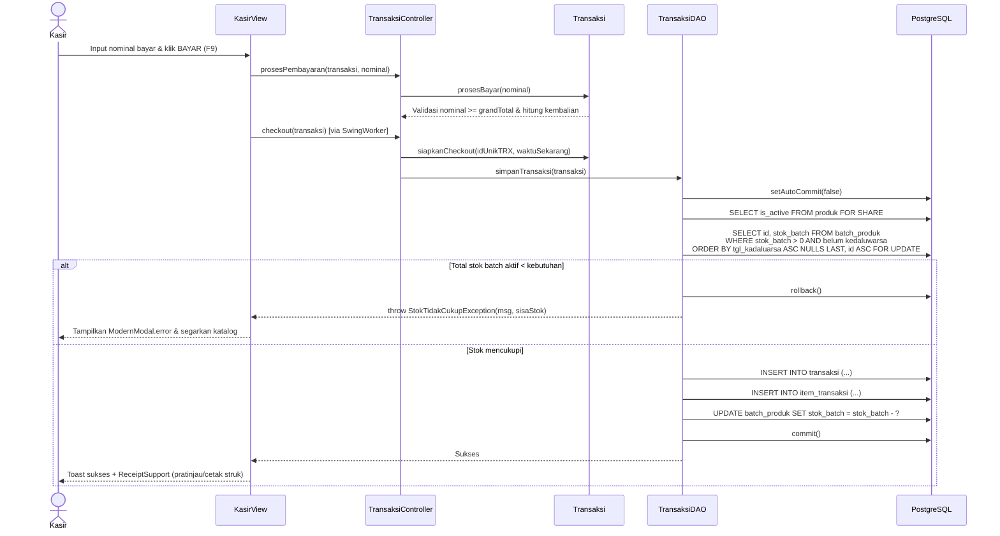

# Java Class Schema & Architecture - SI-RITEL

Dokumen ini memetakan arsitektur aplikasi, struktur paket, diagram kelas, penerapan 4 pilar Pemrograman Berorientasi Objek (PBO), serta alur transaksi pada aplikasi desktop **SI-RITEL** (Sistem Informasi Kasir & Inventaris Ritel) berbasis **Java Swing (JDK 17+)** dan **PostgreSQL (`pgJDBC`)**. Seluruh isi dokumen telah diselaraskan langsung dengan implementasi kode aktual (43 file `.java`).

---

## 1. Struktur Direktori Proyek

```text
Proyek PBO SI-RITEL/
├── README.md                                      # Panduan instalasi & cara menjalankan aplikasi
├── db.properties                                  # Konfigurasi koneksi DB lokal (diabaikan .gitignore)
├── docs/
│   ├── AGENTS.md                                  # Standar arsitektur, aturan OOP, UI, & modul tim
│   ├── Database_Schema.md                         # DDL PostgreSQL, seed data, & query referensi
│   └── Java_Class_Schema_Architecture.md          # Dokumen arsitektur & skema kelas Java (file ini)
├── gambar/                                        # Tangkapan layar & referensi antarmuka tiap halaman
├── lib/
│   └── postgresql-42.7.14.jar                     # Driver JDBC PostgreSQL (pgJDBC)
└── src/
    └── com/
        └── siritel/
            ├── Main.java                          # Entry point aplikasi (SwingUtilities.invokeLater)
            ├── config/
            │   └── DatabaseConnection.java        # Pengelola koneksi JDBC (env var / db.properties)
            ├── exception/
            │   └── StokTidakCukupException.java   # Custom checked exception validasi stok
            ├── model/
            │   ├── Printable.java                 # Interface cetak struk & laporan teks
            │   ├── Pengguna.java                  # Entitas akun pegawai (Admin / Kasir)
            │   ├── Produk.java                    # Abstract class induk katalog produk
            │   ├── Makanan.java                   # Subclass Produk (beratGram, pajak 5%)
            │   ├── Minuman.java                   # Subclass Produk (volumeMl, isDingin, pajak 11% + Rp 500)
            │   ├── Elektronik.java                # Subclass Produk (bulanGaransi, pajak 15% / 17%)
            │   ├── BatchProduk.java               # Entitas batch stok masuk & tanggal kedaluwarsa
            │   ├── ItemTransaksi.java             # Detail item keranjang & snapshot harga/pajak
            │   ├── Transaksi.java                 # Header transaksi, keranjang aktif, & cetak nota
            │   ├── TransaksiRingkas.java          # Model ringkasan baris untuk pagination riwayat
            │   └── LaporanPenjualan.java          # Rekapitulasi omzet & pajak harian per periode
            ├── dao/
            │   ├── PenggunaDAO.java               # Query SQL autentikasi Bcrypt & CRUD pengguna
            │   ├── ProdukDAO.java                 # Query SQL Single Table Inheritance & batch stok
            │   └── TransaksiDAO.java              # Transaksi atomik checkout FEFO, riwayat, & laporan
            ├── controller/
            │   ├── AuthController.java            # Sesi pengguna aktif, aturan admin, & SQLState map
            │   ├── ProdukController.java          # Validasi bisnis produk, batch, & overloading cari
            │   └── TransaksiController.java       # Orkestrasi keranjang, ID transaksi, & checkout
            └── view/
                ├── LoginView.java                 # Layar login asinkron dengan validasi inline
                ├── MainFrame.java                 # Shell navigasi sidebar berbasis role (RBAC)
                ├── ManajemenPenggunaView.java     # Halaman kelola akun Admin & Kasir
                ├── ManajemenProdukView.java       # Halaman katalog produk & manajemen batch stok
                ├── KasirView.java                 # Halaman Point of Sale (katalog, keranjang, bayar)
                ├── RiwayatTransaksiView.java      # Halaman log transaksi, filter, & cetak ulang struk
                ├── LaporanPenjualanView.java      # Halaman rekap harian & pratinjau cetak A4/PDF
                └── ui/                            # Paket komponen UI terpusat (16 file)
                    ├── UITheme.java               # Token warna, font, radius, & parser nominal ID
                    ├── RefreshableView.java       # Interface penyegaran data saat berpindah halaman
                    ├── RoundedButton.java         # Tombol kustom sudut membulat
                    ├── ButtonVariant.java         # Enum varian tombol (PRIMARY, TEAL, DANGER, dll.)
                    ├── RoundedCardPanel.java      # Panel kartu dengan latar & radius konsisten
                    ├── RoundedBorder.java         # Border sudut membulat anti-aliasing
                    ├── RoundedComboBoxUI.java     # Styling dropdown JComboBox modern
                    ├── RoundedTextField.java      # Input teks halaman login
                    ├── RoundedPasswordField.java  # Input sandi dengan tombol tampil/sembunyi
                    ├── InlineAlertPanel.java      # Banner peringatan inline pada layar login
                    ├── ModernDatePicker.java      # Komponen kalender popup pemilih LocalDate
                    ├── ModernModal.java           # Dialog konfirmasi & error dengan backdrop gelap
                    ├── ToastManager.java          # Pengelola notifikasi toast non-blocking
                    ├── ToastType.java             # Enum tipe toast (SUCCESS, INFO)
                    ├── ReceiptSupport.java        # Dialog sukses bayar & pencetakan struk kasir
                    └── LaporanPrinter.java        # Pratinjau multi-halaman A4 & ekspor cetak/PDF
```

---

## 2. Arsitektur Berlapis (Strict MVC + DAO) & Alur Transaksi

Aplikasi memisahkan tanggung jawab ke dalam empat lapisan utama agar logika tampilan tidak bercampur dengan logika bisnis maupun query SQL:



### Aturan Batas Antar-Layer
1. **View (`com.siritel.view` & `view.ui`):** Hanya menangani rendering komponen Java Swing, menangkap event pengguna, menjalankan pemanggilan database di background thread melalui `SwingWorker` (agar *Event Dispatch Thread* tidak membeku), dan menampilkan umpan balik melalui `ModernModal` atau `ToastManager`.
2. **Controller (`com.siritel.controller`):** Menjalankan validasi tingkat aplikasi (seperti larangan menghapus satu-satunya Admin aktif, validasi tanggal kedaluwarsa makanan/minuman, dan pembuatan kode unik `TRX-...`), serta menerjemahkan kode `SQLState` PostgreSQL ke pesan bahasa Indonesia yang mudah dipahami pengguna.
3. **DAO (`com.siritel.dao`):** Satu-satunya paket yang diizinkan mengimpor `Connection`, `PreparedStatement`, dan `ResultSet`. Seluruh parameter dikirim melalui *parameterized query* (`?`) di dalam blok `try-with-resources`.
4. **Model (`com.siritel.model`):** Menyimpan state objek dengan enkapsulasi ketat, validasi invariant di setiap setter/konstruktor, perhitungan pajak polimorfik, dan pemformatan teks cetak (`Printable`).

### Sequence Diagram Proses Checkout Atomik & FEFO



---

## 3. Class Diagram Domain Model & Exception

```mermaid
classDiagram
    class Printable {
        <<interface>>
        +cetak() String
    }

    class StokTidakCukupException {
        <<exception>>
        -sisaStok: int
        +StokTidakCukupException(msg: String, sisaStok: int)
        +getSisaStok() int
    }

    class Produk {
        <<abstract>>
        +MAX_HARGA: double$
        #id: int
        #kode: String
        #nama: String
        #harga: double
        #daftarBatch: List~BatchProduk~
        +Produk(id: int, kode: String, nama: String, harga: double)
        +hitungPajak()* double
        +getInfoSpesifik()* String
        +getJenisProduk()* String
        +getStok() int
        +getStokKadaluarsa() int
        +tambahBatch(batch: BatchProduk) void
        +getDaftarBatch() List~BatchProduk~
        +setDaftarBatch(list: List~BatchProduk~) void
        +getId() int
        +setId(id: int) void
        +getKode() String
        +setKode(kode: String) void
        +getNama() String
        +setNama(nama: String) void
        +getHarga() double
        +setHarga(harga: double) void
    }

    class Makanan {
        -beratGram: int
        +Makanan(id: int, kode: String, nama: String, harga: double, beratGram: int)
        +hitungPajak() double
        +getInfoSpesifik() String
        +getJenisProduk() String
        +getBeratGram() int
        +setBeratGram(beratGram: int) void
    }

    class Minuman {
        -volumeMl: int
        -isDingin: boolean
        +Minuman(id: int, kode: String, nama: String, harga: double, volumeMl: int, isDingin: boolean)
        +hitungPajak() double
        +getInfoSpesifik() String
        +getJenisProduk() String
        +getVolumeMl() int
        +setVolumeMl(volumeMl: int) void
        +isDingin() boolean
        +setDingin(dingin: boolean) void
    }

    class Elektronik {
        -bulanGaransi: int
        +Elektronik(id: int, kode: String, nama: String, harga: double, bulanGaransi: int)
        +hitungPajak() double
        +getInfoSpesifik() String
        +getJenisProduk() String
        +getBulanGaransi() int
        +setBulanGaransi(bulanGaransi: int) void
    }

    class BatchProduk {
        -id: int
        -produkId: int
        -tglMasuk: LocalDate
        -tglKadaluarsa: LocalDate
        -stokBatch: int
        +BatchProduk(id: int, produkId: int, tglMasuk: LocalDate, tglKadaluarsa: LocalDate, stokBatch: int)
        +BatchProduk(produkId: int, tglMasuk: LocalDate, tglKadaluarsa: LocalDate, stokBatch: int)
        +isKadaluarsa() boolean
        +isHampirKadaluarsa(hariBatas: int) boolean
        +getId() int
        +setId(id: int) void
        +getProdukId() int
        +setProdukId(produkId: int) void
        +getTglMasuk() LocalDate
        +setTglMasuk(tglMasuk: LocalDate) void
        +getTglKadaluarsa() LocalDate
        +setTglKadaluarsa(tglKadaluarsa: LocalDate) void
        +getStokBatch() int
        +setStokBatch(stokBatch: int) void
    }

    class Pengguna {
        -id: int
        -username: String
        -password: String
        -namaLengkap: String
        -role: String
        +Pengguna(id: int, username: String, password: String, namaLengkap: String, role: String)
        +getId() int
        +getUsername() String
        +setUsername(username: String) void
        +getPassword() String
        +setPassword(password: String) void
        +getNamaLengkap() String
        +setNamaLengkap(namaLengkap: String) void
        +getRole() String
        +setRole(role: String) void
    }

    class ItemTransaksi {
        -produk: Produk
        -kuantitas: int
        -hargaSatuan: double
        -pajakSatuan: double
        -subtotal: double
        +ItemTransaksi(produk: Produk, kuantitas: int)
        +ItemTransaksi(produk: Produk, kuantitas: int, hargaSatuan: double, pajakSatuan: double, subtotal: double)
        +hitungSubtotal() double
        +hitungPajakItem() double
        +getProduk() Produk
        +getKuantitas() int
        +getHargaSatuan() double
        +getPajakSatuan() double
        +getSubtotal() double
        +setKuantitas(kuantitas: int) void
    }

    class Transaksi {
        -idTransaksi: String
        -tanggal: LocalDateTime
        -kasir: Pengguna
        -listKeranjang: List~ItemTransaksi~
        -subtotalBarang: double
        -totalPajak: double
        -grandTotal: double
        -bayar: double
        -kembalian: double
        +Transaksi(idTransaksi: String, kasir: Pengguna)
        +Transaksi(idTransaksi: String, tanggal: LocalDateTime, kasir: Pengguna, listKeranjang: List~ItemTransaksi~, subtotalBarang: double, totalPajak: double, grandTotal: double, bayar: double, kembalian: double)
        +siapkanCheckout(idTransaksiBaru: String, waktuCheckout: LocalDateTime) void
        +tambahItem(produk: Produk, qty: int) void
        +ubahKuantitas(produk: Produk, qty: int) void
        +hapusItem(produk: Produk) void
        +bersihkanKeranjang() void
        +sinkronkanDenganKatalog(katalogTerbaru: Map) List~String~
        +hitungSubtotalBarang() double
        +hitungTotalPajak() double
        +hitungGrandTotal() double
        +prosesBayar(nominal: double) void
        +cetak() String
    }

    class TransaksiRingkas {
        -idTransaksi: String
        -tanggal: LocalDateTime
        -namaKasir: String
        -jumlahItem: int
        -grandTotal: double
        +TransaksiRingkas(idTransaksi: String, tanggal: LocalDateTime, namaKasir: String, jumlahItem: int, grandTotal: double)
        +getIdTransaksi() String
        +getTanggal() LocalDateTime
        +getNamaKasir() String
        +getJumlahItem() int
        +getGrandTotal() double
    }

    class LaporanPenjualan {
        -periodeAwal: LocalDate
        -periodeAkhir: LocalDate
        -daftarTransaksi: List~Transaksi~
        +LaporanPenjualan(awal: LocalDate, akhir: LocalDate, list: List~Transaksi~)
        +hitungTotalOmzet() double
        +hitungTotalPajakTerkumpul() double
        +hitungJumlahTransaksi() int
        +getDaftarHarian() Map
        +hitungOmzetHarian(transaksiHarian: List~Transaksi~) double
        +hitungPajakHarian(transaksiHarian: List~Transaksi~) double
        +getPeriodeAwal() LocalDate
        +getPeriodeAkhir() LocalDate
        +cetak() String
    }

    Produk <|-- Makanan
    Produk <|-- Minuman
    Produk <|-- Elektronik
    Produk "1" o-- "*" BatchProduk : memiliki
    ItemTransaksi "*" --> "1" Produk : mengacu
    Transaksi "1" *-- "0..*" ItemTransaksi : berisi
    Transaksi "*" --> "1" Pengguna : dilayani oleh
    Transaksi ..|> Printable
    LaporanPenjualan ..|> Printable
    LaporanPenjualan "1" o-- "*" Transaksi : merekap
    Transaksi ..> StokTidakCukupException : throws
```



---

## 4. Pemetaan 4 Pilar PBO & Exception Handling (Materi Inti Presentasi)

Tabel berikut merangkum bukti implementasi konsep PBO di dalam kode sumber SI-RITEL:

| Konsep PBO | Lokasi Kelas | Bentuk Implementasi Nyata di Kode |
| :--- | :--- | :--- |
| **1. Enkapsulasi** | Seluruh kelas di `com.siritel.model` | Seluruh atribut dideklarasikan `private` (atau `protected` khusus pada `Produk` agar dapat diakses subclass). Koleksi internal dilindungi dengan `Collections.unmodifiableList(...)` (`Produk.getDaftarBatch()`, `Transaksi.getListKeranjang()`) dan `Collections.unmodifiableMap(...)` (`LaporanPenjualan.getDaftarHarian()`). Seluruh setter numerik (`setHarga`, `setBeratGram`, `setVolumeMl`, `setBulanGaransi`, `setStokBatch`, `setKuantitas`) menolak nilai ilegal dengan `IllegalArgumentException`. |
| **2. Pewarisan (*Inheritance*)** | `Produk` -> `Makanan`, `Minuman`, `Elektronik` | Ketiga subclass mewarisi atribut dan perilaku stok multi-batch dari `Produk`, memanggil konstruktor induk via `super(id, kode, nama, harga)`, lalu menambahkan atribut spesifik kategori masing-masing. Di sisi PostgreSQL dipetakan dengan pola *Single Table Inheritance* pada tabel `produk`. |
| **3. Abstraksi (*Abstract Class* & *Interface*)** | `Produk`, `Printable`, `RefreshableView` | `Produk` adalah `abstract class` yang mendefinisikan kontrak `hitungPajak()`, `getInfoSpesifik()`, dan `getJenisProduk()`. `Printable` adalah `interface` (`String cetak()`) yang diimplementasikan oleh dua kelas berbeda domain: `Transaksi` (format struk kasir) dan `LaporanPenjualan` (format tabel rekap periode). Selain itu, `RefreshableView` (`void refreshData()`) diimplementasikan oleh seluruh 5 panel halaman utama agar `MainFrame` dapat menyegarkan halaman aktif secara seragam saat pengguna berpindah menu. |
| **4a. Polimorfisme (*Overriding*)** | `Makanan`, `Minuman`, `Elektronik`, `Transaksi`, `LaporanPenjualan` | *Runtime polymorphism*: `ItemTransaksi` dan `ManajemenProdukView` memanggil `produk.hitungPajak()` dan `produk.getInfoSpesifik()` langsung melalui referensi bertipe `Produk` tanpa percabangan `if-else` perhitungan tarif pajak. |
| **4b. Polimorfisme (*Overloading*)** | `ProdukController`, `BatchProduk`, `ItemTransaksi`, `Transaksi` | *Compile-time polymorphism*: (1) *Method overloading* pada `ProdukController.cariProduk(String nama)` untuk pencarian lintas semua jenis dan `cariProduk(String nama, String jenis)` untuk pencarian terfilter kategori; (2) *Constructor overloading* pada `BatchProduk` (tanpa/dengan `id`), `ItemTransaksi` (keranjang aktif vs pemuatan histori DB), dan `Transaksi` (keranjang baru vs transaksi historis). |
| **5. Custom Exception Handling** | `StokTidakCukupException`, `Transaksi`, `TransaksiDAO`, `KasirView` | Checked exception `StokTidakCukupException` menyimpan `sisaStok` aktual. Dilempar saat penambahan/pengubahan kuantitas keranjang melebihi stok aktif maupun saat terjadi *race condition* penguncian batch di database, lalu ditangkap di layer View untuk ditampilkan melalui `ModernModal.error(...)`. |

---

## 5. Spesifikasi Detail Kelas per Package

### A. Package `com.siritel.config` & `com.siritel.exception`

1. **`DatabaseConnection`**
   * Utility class (`private` constructor) penyedia `public static Connection getConnection() throws SQLException`.
   * Membaca kredensial secara berurutan dari environment variable (`DB_URL`, `DB_USER`, `DB_PASSWORD`) dengan *fallback* ke file lokal `db.properties` (`db.url`, `db.user`, `db.password`), lalu menyimpannya di cache *thread-safe* (`volatile DbConfig`).
   * Menetapkan `connectTimeout = 10` detik dan `socketTimeout = 15` detik agar antarmuka tidak menggantung lama apabila server PostgreSQL mati.
2. **`StokTidakCukupException` (extends `Exception`)**
   * Menyimpan atribut `private final int sisaStok` (divalidasi `>= 0`) dan menyediakan `getSisaStok()` agar dialog peringatan di kasir dapat menampilkan sisa stok yang masih bisa dibeli secara akurat.

### B. Package `com.siritel.model`

1. **`Printable` (Interface)**
   * Kontrak tunggal `String cetak()` untuk menghasilkan teks monospaced siap cetak/salin pada `Transaksi` dan `LaporanPenjualan`.
2. **`Produk` (Abstract Class)**
   * **Konstanta:** `MAX_HARGA = 9_999_999_999.99` (selaras dengan kapasitas kolom `NUMERIC(12, 2)` di PostgreSQL).
   * **Atribut:** `protected int id`, `protected String kode` (maks 30 karakter), `protected String nama` (maks 150 karakter), `protected double harga` (`0 <= harga <= MAX_HARGA`), `protected List<BatchProduk> daftarBatch`.
   * **Agregasi Stok Dinamis:**
     * `getStok()`: Menjumlahkan `stokBatch` hanya dari batch yang **belum kedaluwarsa** (`!batch.isKadaluarsa()`).
     * `getStokKadaluarsa()`: Menjumlahkan `stokBatch` dari batch yang sudah melewati tanggal kedaluwarsa sebagai informasi audit inventaris.
   * **Abstract Methods:** `hitungPajak()`, `getInfoSpesifik()`, dan `getJenisProduk()`.
3. **`Makanan` (extends `Produk`)**
   * **Atribut:** `private int beratGram` (wajib `> 0`).
   * **Kebijakan Pajak:** Tarif pajak pangan rendah sebesar **5%** dari harga jual (`harga * 0.05`).
   * **Info Spesifik & Jenis:** `beratGram + " gram"`, jenis `"MAKANAN"`.
4. **`Minuman` (extends `Produk`)**
   * **Atribut:** `private int volumeMl` (wajib `> 0`), `private boolean isDingin`.
   * **Kebijakan Pajak:** PPN **11%** ditambah biaya layanan pendingin (*chiller*) **Rp 500** per unit jika `isDingin == true` (`(harga * 0.11) + (isDingin ? 500.0 : 0.0)`).
   * **Info Spesifik & Jenis:** `volumeMl + " ml" + (isDingin ? " (Dingin)" : "")`, jenis `"MINUMAN"`.
5. **`Elektronik` (extends `Produk`)**
   * **Atribut:** `private int bulanGaransi` (wajib `>= 0`).
   * **Kebijakan Pajak:** PPN 11% + asuransi barang elektronik 4% = **15%** untuk garansi `<= 12` bulan, atau **17%** (tambahan 2% proteksi garansi panjang) jika `bulanGaransi > 12`.
   * **Info Spesifik & Jenis:** `"Garansi " + bulanGaransi + " bln"`, jenis `"ELEKTRONIK"`.
6. **`BatchProduk`**
   * **Atribut:** `id`, `produkId` (`>= 0`), `tglMasuk` (default `LocalDate.now()` jika null pada konstruktor), `tglKadaluarsa` (wajib diisi untuk makanan/minuman, `null` untuk elektronik), dan `stokBatch` (`>= 0`).
   * **Metode Status:** `isKadaluarsa()` bernilai `true` jika `tglKadaluarsa != null && tglKadaluarsa.isBefore(LocalDate.now())`; `isHampirKadaluarsa(int hariBatas)` menandai batch yang akan kedaluwarsa dalam rentang `hariBatas` hari ke depan (dipakai untuk indikator warna kuning 7 hari di tabel batch).
7. **`Pengguna`**
   * **Atribut:** `id`, `username` (maks 50 karakter), `password` (minimal 6 karakter saat diisi; bernilai `null` ketika objek dimuat dari database demi keamanan memori), `namaLengkap` (maks 100 karakter), dan `role` (hanya menerima `"Admin"` atau `"Kasir"`).
8. **`ItemTransaksi`**
   * **Konstruktor Aktif `(Produk produk, int kuantitas)`:** Mengambil *snapshot* `hargaSatuan = produk.getHarga()` dan `pajakSatuan = produk.hitungPajak()` (dibulatkan 2 desimal `RoundingMode.HALF_UP`) tepat saat produk masuk keranjang.
   * **Konstruktor Historis `(Produk, int, double, double, double)`:** Merekonstruksi item dari tabel `item_transaksi` menggunakan harga dan pajak historis saat transaksi terjadi, sehingga kenaikan harga master produk di kemudian hari tidak mengubah struk lama.
9. **`Transaksi` (implements `Printable`)**
   * Mengelola siklus keranjang belanja aktif (`tambahItem`, `ubahKuantitas`, `hapusItem`, `bersihkanKeranjang`, `sinkronkanDenganKatalog`), perhitungan presisi `BigDecimal` 2 desimal (`hitungSubtotalBarang`, `hitungTotalPajak`, `hitungGrandTotal`), validasi pembayaran (`prosesBayar`), pembaruan ID/waktu sesaat sebelum simpan (`siapkanCheckout`), serta pencetakan nota (`cetak()`).
10. **`TransaksiRingkas`**
    * Objek nilai (*immutable value object*) berisi `idTransaksi`, `tanggal`, `namaKasir`, `jumlahItem`, dan `grandTotal` untuk kebutuhan tabel berhalaman (*pagination*) pada `RiwayatTransaksiView` agar aplikasi tidak perlu memuat detail item seluruh transaksi sekaligus.
11. **`LaporanPenjualan` (implements `Printable`)**
    * Memvalidasi periode (`awal <= akhir`) dan memastikan seluruh objek `Transaksi` berada di dalam rentang tanggal laporan.
    * Menyediakan agregasi total (`hitungTotalOmzet`, `hitungTotalPajakTerkumpul`, `hitungJumlahTransaksi`), pengelompokan deret tanggal lengkap dari `periodeAwal` hingga `periodeAkhir` termasuk hari dengan 0 transaksi (`getDaftarHarian`), perhitungan sub-total harian, dan output laporan teks (`cetak()`).

### C. Package `com.siritel.dao`

1. **`PenggunaDAO`**
   * `login(String username, String passwordPlain)`: Autentikasi sisi server PostgreSQL menggunakan `password = crypt(?, password) AND is_active = TRUE`.
   * `getAll()`, `getById(int id)`, `countActiveAdmins()`: Membaca akun aktif.
   * `insert(Pengguna p)` & `update(Pengguna p, boolean gantiPassword)`: Menyimpan hash Bcrypt `crypt(?, gen_salt('bf'))` tanpa pernah menyimpan *plaintext password*.
   * `delete(int id)`: Menerapkan **hybrid soft-delete** dalam satu transaksi database (`FOR UPDATE`): jika pengguna sudah pernah melayani transaksi di tabel `transaksi`, status diubah menjadi `is_active = FALSE` (mengembalikan `true`); jika belum pernah bertransaksi, baris dihapus permanen (`DELETE`, mengembalikan `false`).
2. **`ProdukDAO`**
   * `insert(Produk p)` & `update(Produk p)`: Memetakan hierarki `Makanan`, `Minuman`, dan `Elektronik` ke kolom tabel `produk` (mengambil ID baru via `RETURNING id`).
   * `delete(int id)`: Menerapkan **hybrid soft-delete** (`is_active = FALSE` beserta pembersihan sisa `batch_produk` apabila produk sudah tercatat di `item_transaksi`, atau *hard delete* jika belum pernah ditransaksikan).
   * `getAll()` & `search(String keyword, String jenisProduk)`: Membaca katalog produk aktif (`ILIKE` pada nama/kode) lalu memuat seluruh batch milik produk-produk tersebut sekaligus dalam **satu query kedua** (`WHERE produk_id = ANY(?) ORDER BY tgl_kadaluarsa ASC NULLS LAST, id ASC`) lewat helper `muatBatchUntukProduk(...)` sehingga bebas dari masalah *N+1 query*.
   * `getById(int id)`: Memuat satu produk beserta daftar batch-nya melalui helper internal `muatBatchByProdukId(...)`.
   * `tambahBatch(BatchProduk batch)` & `deleteBatch(int batchId)`: Mencatat batch stok masuk baru (`RETURNING id`) atau menghapus batch tertentu.
3. **`TransaksiDAO`**
   * `simpanTransaksi(Transaksi transaksi)`: Menyimpan transaksi secara **atomik** (`setAutoCommit(false)` -> validasi nominal & kecocokan header-detail -> `FOR SHARE` cek produk aktif -> `FOR UPDATE` kunci batch belum kedaluwarsa dengan urutan FEFO -> `INSERT transaksi` -> `INSERT item_transaksi` -> `UPDATE batch_produk` -> `commit()`, atau `rollback()` penuh saat gagal).
   * `getRiwayatTransaksi(...)` & `getJumlahRiwayatTransaksi(...)`: Pencarian server-side berdasarkan rentang tanggal, kata kunci ID transaksi / nama kasir, serta `LIMIT` dan `OFFSET`.
   * `getDetailTransaksi(String idTransaksi)`: Memuat satu `Transaksi` utuh beserta `ItemTransaksi` historis (tetap dapat membaca nama kasir/produk yang sudah di-*soft-delete*).
   * `getLaporanPenjualan(LocalDate tanggalAwal, LocalDate tanggalAkhir)`: Memuat daftar transaksi pada rentang periode `[awal 00:00, akhir+1 00:00)` dan membungkusnya ke dalam `LaporanPenjualan`.

### D. Package `com.siritel.controller`

1. **`AuthController`**
   * Menyimpan sesi `penggunaAktif`, mengelola `login`/`logout`, memvalidasi aturan perlindungan akun Admin (mencegah penghapusan atau penurunan role akun yang sedang dipakai maupun satu-satunya Admin aktif di sistem), serta menyediakan `pesanSqlError(SQLException)`.
2. **`ProdukController`**
   * Mengelola `daftarProduk()`, `tambahProduk(Produk)`, `ubahProduk(Produk)` (mencegah perubahan kategori antara Elektronik dan Makanan/Minuman selama produk masih memiliki batch aktif agar tidak melanggar aturan tanggal kedaluwarsa), `hapusProduk(int)`, `tambahStokBatch(BatchProduk)`, dan `hapusBatch(int)`.
   * Menyediakan **method overloading** `cariProduk(String nama)` dan `cariProduk(String nama, String jenis)` beserta `pesanSqlError(SQLException)`.
3. **`TransaksiController`**
   * Mengorkestrasi pembuatan sesi transaksi (`buatTransaksi`), manipulasi item keranjang, `prosesPembayaran`, dan `checkout(Transaksi)` dengan format ID unik `"TRX-" + yyyyMMddHHmmss + "-" + kasirId + 3DigitAcak` (maksimal <= 30 karakter sesuai `VARCHAR(30)`).
   * Menyediakan akses riwayat berhalaman, detail struk, `buatLaporan(LocalDate, LocalDate)`, dan `pesanSqlError(SQLException)`.

### E. Package `com.siritel.view` & Hak Akses Halaman (RBAC)

Seluruh halaman konten mengimplementasikan `RefreshableView` dan dikelola menggunakan `CardLayout` di dalam `MainFrame`:

| Halaman View | Kelas | Akses Admin | Akses Kasir | Komponen Input & Fitur Utama |
| :--- | :--- | :---: | :---: | :--- |
| **Login** | `LoginView` | Ya | Ya | `RoundedTextField`, `RoundedPasswordField`, `InlineAlertPanel`, animasi *shake* saat gagal, autentikasi `SwingWorker`. |
| **Kasir (POS)** | `KasirView` | Ya | Ya | Grid kartu produk responsif (2/3 kolom), filter kategori, shortcut keyboard (`F2`, `F9`, `Esc`), sinkronisasi keranjang otomatis, cetak struk (`ReceiptSupport`). |
| **Manajemen Produk & Batch** | `ManajemenProdukView` | Ya | Tidak | Tabel katalog + pajak polimorfik, `JComboBox` jenis, `JSpinner` (`beratGram`, `volumeMl`, `bulanGaransi`, `stokBatch`), `JCheckBox` (`isDingin`), `ModernDatePicker` batch, indikator warna kedaluwarsa. |
| **Manajemen Pengguna** | `ManajemenPenggunaView` | Ya | Tidak | Tabel akun + badge role, panel samping dinamis, `JRadioButton` (`Admin`/`Kasir`), *password eye-toggle*, konfirmasi hapus `ModernModal`. |
| **Riwayat Transaksi** | `RiwayatTransaksiView` | Ya | Ya | Filter periode `ModernDatePicker`, pencarian *debounce* 300 ms, pagination 10 baris/halaman (`TransaksiRingkas`), panel detail & cetak ulang struk. |
| **Laporan Penjualan** | `LaporanPenjualanView` | Ya | Tidak | 3 kartu KPI (Jumlah Transaksi, Total Omzet, Total Pajak), tabel rincian harian, salin teks `Printable.cetak()`, pratinjau & cetak dokumen A4 (`LaporanPrinter`). |

---

## 6. Catatan Desain Penting (Bahan Tanya-Jawab Presentasi)

1. **Mengapa tabel `produk` tidak memiliki kolom `stok`?**
   Karena satu produk makanan/minuman dapat datang dalam beberapa pengiriman (*batch*) dengan tanggal kedaluwarsa berbeda. Menyimpan satu angka stok di tabel `produk` berisiko menimbulkan ketidaksinkronan data dan tidak bisa memisahkan stok layak jual dari stok kedaluwarsa. Pada SI-RITEL, `Produk.getStok()` menghitung stok aktif secara dinamis dari `daftarBatch` yang belum kedaluwarsa, sedangkan pemotongan stok saat checkout selalu mengambil batch dengan kedaluwarsa paling dekat terlebih dahulu (**FEFO - *First Expired, First Out***).
2. **Bagaimana sistem menjaga keutuhan struk lama jika produk/kasir dihapus atau harga barang naik?**
   Melalui kombinasi dua mekanisme:
   * **Snapshot Transaksi:** Saat item masuk ke keranjang, `ItemTransaksi` langsung menyalin `hargaSatuan` dan `pajakSatuan` ke kolom tabel `item_transaksi`. Perubahan harga di tabel `produk` tidak mengubah nilai historis di `item_transaksi`.
   * **Hybrid Soft Delete:** Jika produk atau akun kasir sudah pernah direferensikan oleh tabel `transaksi` / `item_transaksi`, DAO tidak menjalankan `DELETE` fisik (yang akan ditolak `ON DELETE RESTRICT`), melainkan menonaktifkannya dengan `is_active = FALSE` serta memakai *partial unique index* (`WHERE is_active = TRUE`) agar kode produk atau username tersebut tetap bisa dipakai ulang di masa depan.
3. **Bagaimana sistem mencegah *race condition* jika dua kasir membeli produk yang sama bersamaan?**
   Di dalam `TransaksiDAO.simpanTransaksi()`, seluruh pembacaan stok batch dijalankan dalam satu transaksi (`conn.setAutoCommit(false)`) menggunakan klausa penguncian baris `SELECT ... FOR UPDATE` yang diurutkan berdasarkan `produk_id` terkecil (`TreeMap`) untuk mencegah *deadlock*. Transaksi kedua akan menunggu hingga transaksi pertama selesai `commit()`, lalu membaca sisa stok terbaru secara akurat.
4. **Catatan Optimasi pada `LaporanPenjualan`:**
   Saat menyusun laporan periode di `TransaksiDAO.getLaporanPenjualan()`, objek `Transaksi` historis dibentuk dari tabel header `transaksi` dengan `listKeranjang` kosong (`new ArrayList<>()`) agar rekap ribuan transaksi tidak terbebani query join detail item. Perhitungan di `LaporanPenjualan` membaca nilai yang sudah tersimpan melalui `getGrandTotal()` dan `getTotalPajak()` (bukan memanggil ulang `hitungGrandTotal()` yang menghitung dari `listKeranjang`).

---

## 7. Pembagian Modul Tim (3 Anggota)

* **Modul 1 (Fondasi, Autentikasi & Manajemen Pengguna):** `Main`, `DatabaseConnection`, `Pengguna`, `PenggunaDAO`, `AuthController`, `LoginView`, `MainFrame`, `ManajemenPenggunaView`.
* **Modul 2 (Katalog Produk, Polimorfisme Pajak & Multi-Batch FEFO):** `Produk`, `Makanan`, `Minuman`, `Elektronik`, `BatchProduk`, `ProdukDAO`, `ProdukController`, `ManajemenProdukView`.
* **Modul 3 (Transaksi Kasir, Riwayat & Laporan Penjualan):** `Printable`, `StokTidakCukupException`, `ItemTransaksi`, `Transaksi`, `TransaksiRingkas`, `LaporanPenjualan`, `TransaksiDAO`, `TransaksiController`, `KasirView`, `RiwayatTransaksiView`, `LaporanPenjualanView`.
* **Komponen Antarmuka Bersama (`com.siritel.view.ui`):** Digunakan lintas seluruh modul untuk menjaga konsistensi desain kartu, tombol, input tanggal, dialog modal, notifikasi toast, dan pencetakan dokumen.
